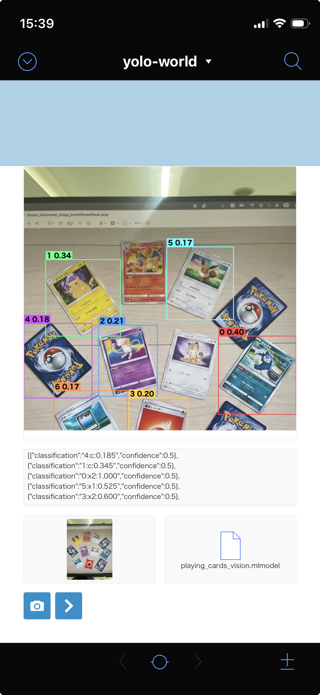
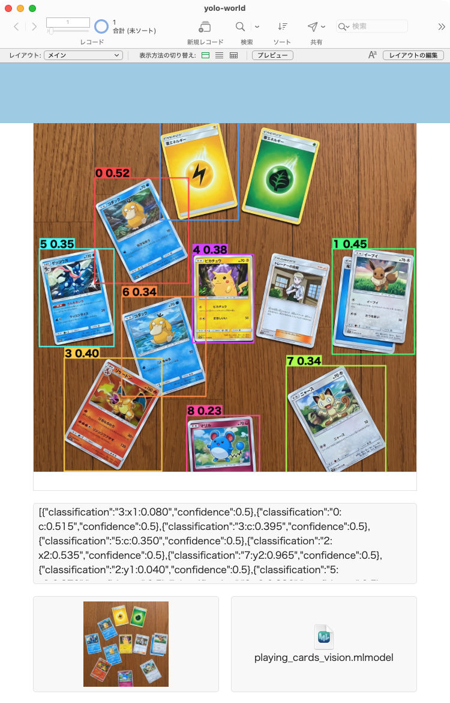

# yolo-world

YOLO-World(ゼロショット物体検出)でトランプのカードを検出し、FileMaker から座標を取得して描画する。

## 画面

FileMaker の Web ビューアに、検出した枠を描いたところ(左: iOS、右: Mac)。

 

## 構成

| ファイル | 役割 |
|---|---|
| `convert.py` | `yolov8s-world.pt` に "card" を設定し、`playing_cards_yolo.pt` と `playing_cards_yolo.mlmodel`(NMS 入り)を書き出す |
| `build_vision_model.py` | `playing_cards_yolo.mlmodel` を、FileMaker の Vision で座標が取れる `playing_cards_vision.mlmodel` に変換する |
| `draw_boxes.html` | `ComputeModel` の結果から、画像の上にボックスを描く(FileMaker の Web ビューア用)。検出したカードの切り出し(`getCrops`)と、価格などの表示(`setCardInfo`)もできる |
| `card_lookup.py` | カード画像を Gemini で読み取り、PokéWallet で価格を取得して、`setCardInfo` 用の JSON を出す |
| `verify_samples.py` | `samples/` の画像を Gemini で読み取り、同名の `.json`(正解)と照合する |

## 手順

Python 3.9 以降。

```
python3 -m venv .venv && . .venv/bin/activate
pip install ultralytics coremltools "git+https://github.com/ultralytics/CLIP.git"

python convert.py
python build_vision_model.py playing_cards_yolo.mlmodel playing_cards_vision.mlmodel
```

`convert.py` は、`yolov8s-world.pt` を自動でダウンロードする。macOS が必要(Core ML の書き出しと確認のため)。生成したモデルは、このリポジトリには含まれない。

`playing_cards_vision.mlmodel` を、FileMaker のコンテナフィールドに入れる。

## FileMaker 側の仕様

- スクリプト: `機械学習モデルを構成 [ 処理: Vision ; 名前: "yolo" ; 次から: テーブル::モデル ]`
- 呼び出し: `ComputeModel ( "yolo" ; テーブル::写真 )`。オプションの `confidenceLowerLimit` は **0.25**(座標ラベルの確率が 0.5 のため、有効なラベルだけが返る)。
- 入力は、任意サイズの画像。モデルの先頭で、書き出し時の入力サイズ(`convert.py` の `IMGSZ`、現在 1280)にリサイズする。

### 結果の形式

分類結果の JSON 配列。各要素の `classification` が `カード番号:軸:値` で、`confidence` が 0.5(有効なラベル)。

```
[{"classification":"0:y2:0.415","confidence":0.5}, {"classification":"3:x2:0.615","confidence":0.5}, ...]
```

- カード番号: 0〜9。0 が最も信頼度の高いカード(最大 10 枚)。順序は並び順に依存しない(接頭辞で判別する)。
- 軸: `x1`、`y1`、`x2`、`y2`(左上と右下)、`c`(信頼度)。
- 値: 0〜1 の正規化値。0.005 刻み(1280px の画像で約 6px)。ピクセルにするには、画像の幅・高さを掛ける。

### 画像の向き(EXIF)

iPhone の縦撮りの写真は、画素が横向きのまま保存され、EXIF の向き(Orientation 6 など)で縦に見せている。**FileMaker の `ComputeModel` は EXIF を無視して、回転前の(横向きの)画素で推論する。** 一方、Web ビューアのブラウザは EXIF を反映して縦に描く。そのため、座標が縦向きの画像とずれる(2026-10-16、`IMG_5177.JPG` で確認。macOS の Vision を直接動かすと EXIF が反映され、ずれない)。

`draw_boxes.html` は、画像の EXIF の向きを読み取り、座標を表示の向きに変換する(向き 1〜8 に対応)。EXIF のない画像(アプリで正方形に書き出したものなど)は、変換しない。FileMaker の Web ビューアで、枠が正しい位置に出ることを確認した(2026-10-16、向き 6 の `IMG_5177.JPG`)。向き 6 以外は、実機では未確認。

- 横向きの画素で推論するので、検出の精度は、縦向きで推論するより少し下がる(ずれは 0.03 程度、枠の位置は合う)。精度を優先するなら、FileMaker に渡す前に、画素を縦向きに回転して EXIF を外す。
- ブラウザが EXIF を無視する環境では、この変換は逆に作用する(Web ビューアは EXIF を反映している)。

### 描画

`draw_boxes.html` を Web ビューアに渡す。`__IMAGE__` を `"data:image/jpeg;base64," & Base64EncodeRFC ( 4648 ; テーブル::写真 )`、`__JSON__` を `ComputeModel` の結果で Substitute する。引数の順は、RFC 番号が先で、データが後。逆にすると、写真ではなく `4648` の文字列が変換されて、何も描画されない。

注意: `Base64Encode` などで改行が入っても、HTML 側で空白を除去するので問題ない。プレースホルダは、`script` タグの中に 1 か所ずつだけ書く。コメントなどに書くと、Substitute で全部置換されて、JavaScript が構文エラーになり、何も描画されない。

カード情報の取得(下記)を使うときは、次も Substitute する。

| プレースホルダ | 内容 |
|---|---|
| `__GEMINI_API_KEY__` | Gemini の API キー |
| `__POKEWALLET_API_KEY__` | PokéWallet の API キー |
| `__GEMINI_MODEL__` | 任意。置換しない(または空)と `gemini-3.1-flash-lite` |

置換していないプレースホルダは、HTML 側で「未設定」として扱う。

## 設計上の注意(動作確認の結果)

FileMaker の機械学習機能は制約が多く、次の方式でのみ動作を確認した(2026-10-15、実機)。

- **`.mlpackage` は読み込めない。** `.mlmodel`(NeuralNetwork)だけが読み込める。`format="mlmodel"` で書き出す。`coremltools` で `.mlpackage` を `.mlmodel` に変換することはできない(ML Program は `.mlmodel` で保存できない)。
- **配列や double の出力は使えない。** 多次元配列の出力は読み込みエラー、double の出力は `ComputeModel` が `?` を返す(エラーコードは 0)。
- **「処理: 一般」は、画像入力のモデルで `?` になる。** 「処理: Vision」を使う。
- **Vision は分類結果(ラベル+確率)だけを返す。** そのため、座標を「ラベル+確率」にエンコードしている(`build_vision_model.py`)。各座標の値を 201 段階に量子化し、該当するラベルだけに確率 0.5 を与える。
- 確率は **0.25 ではなく 0.5** にしている。softmax の誤差で 0.24999… となり、しきい値 0.25 で落ちたため。
- `GetModelAttributes` の出力は、型にかかわらず `unknown` と表示される(判断材料にならない)。

## モデルの仕様

- クラスは `"card"` の1つのみ。**`"playing card"` だと、トランプ画像でほぼ検出されない**(ゼロショットの限界)。種類(スート・数字)は区別しない。
- 入力サイズは `convert.py` の `IMGSZ`(32 の倍数、現在 1280)。大きいほど小さいカードに強いが、遅くなり、モデルも大きくなる。`build_vision_model.py` は、サイズを `.mlmodel` から自動で読み取る。YOLO-World は 640 で学習されているので、大きくしても精度が上がるとは限らない。
- YOLO-World は、テキストの埋め込みをモデルに焼き込む。クラスを変えるときは、再エクスポートが必要。
- `build_vision_model.py` の固定値: 最大 10 枚(`K_CARDS`)、検出しきい値 0.05(`SCORE`)、IoU 0.45(`IOU`)、刻み 201 段階(`N`)。実行時には変えられないので、変えるときは再生成する。
- NMS は、モデル内の NeuralNetwork の NMS レイヤーで行う。空きスロット(スコア 0)は、確率が 0 になる。

## 既知の制約

- ゼロショットの精度は高くない。重なったカードは、まとめて1つのボックスになることがある。精度が必要なら、カード画像でのファインチューニングが必要。
- `coremltools` は、torch 2.8.0 を未検証として警告を出す(変換自体は動作する)。
- 座標は、画像を `IMGSZ` 四方に引き伸ばして推論した結果。アスペクト比は保持していない(座標は正規化値なので、元画像にそのまま掛けられる)。

## カード情報と価格の取得(検証中)

ポケモンカード(日本語版)の名前・番号・レアリティを読み取り、現在の価格(円)を取得する。検出(YOLO)とは別の処理で、通信は FileMaker 側のスクリプトから行う想定(API キーを HTML に埋めないため)。

```
画像 → ①検出(YOLO) → ②各カードを切り出し(getCrops) → ③Gemini で読み取り → ④PokéWallet で価格取得 → ⑤表示(setCardInfo)
```

①②⑤は `draw_boxes.html`、③④は `card_lookup.py`。現状は ③④ を、単体のカード画像で検証した段階(2026-10-15)。

### 設定

`.env.example` を `.env` にコピーして、キーを入れる(`.env` は git に入らない)。

| 変数 | 内容 |
|---|---|
| `GEMINI_API_KEY` | Google Gemini |
| `POKEWALLET_API_KEY` | PokéWallet(`X-API-Key` ヘッダーで送る) |
| `GEMINI_MODEL` | 任意。既定は `gemini-3.1-flash-lite` |
| `USD_JPY` | 任意。指定すると為替 API を呼ばず、この値で円に換算する |

`POKEMON_PRICE_TRACKER_API_KEY` も `.env.example` にあるが、現在は使っていない(下記)。

```
python verify_samples.py                                  # 読み取りの検証
python card_lookup.py samples/*.webp                      # 読み取り + 価格取得
```

`requests` が必要。`samples/` は、検証用のカード画像と、同名の `.json`(ハレルヤの商品データ。`title` が `名前(レアリティ){タイプ}〈番号〉[セット記号]`)。権利関係が不明確なので、git には入れない想定。

### FileMaker の操作と draw_boxes.html の関数

| ボタン | 処理 | 呼ぶもの |
|---|---|---|
| 1 | 写真から、枠を表示する | Web ビューアに HTML を渡す(上記の Substitute)。取得は始めない |
| 2 | 枠のカードの情報を、まとめて取得する | `Perform JavaScript` で `lookupAll()` |
| 3 | 取得した JSON を受け取り、FileMaker のデータを作る(FileMaker 側で作成) | `Perform JavaScript` で `getJSON()`。JSON はスクリプト `callback` に渡る |

- `lookupAll()`: 取得を始める。すぐに文字列を返す(`started:3`、実行中は `busy`、`error:no image` / `error:no cards` / `error:no api key`)。カードごとに並列で、Gemini → PokéWallet を呼ぶ。完了までは数秒〜十数秒。
- `getStatus()`: `{"state":"idle|running|done","total":3,"done":2,"error":""}` の JSON 文字列。ボタン 3 を押す前に `done` を確認する。
- `getJSON()`: 取得結果の JSON 文字列(下記)。取得の途中でも呼べるが、未完了のカードは `status` が `pending` / `running`。
- **`getJSON()` の呼び出し時のコールバック:** `getJSON()` を呼ぶと、その時点の結果を `FileMaker.PerformScriptWithOption( "callback", JSON, "0" )` で、FileMaker のスクリプト **`callback`**(名前は固定)に渡す。スクリプトの中では `Get ( ScriptParameter )` で受け取る。同じ JSON を、`Perform JavaScript` の結果(`Get ( ScriptResult )`)としても返す。オプション `0` は「続行」(現在のスクリプトが終わってから、キューのスクリプトを順に実行する。省略時の既定値)。[オプションの説明](https://help.claris.com/ja/pro-help/content/options-for-starting-scripts.html)。`callback` という名前のスクリプトが必要。**`lookupAll()` の完了時には、コールバックを呼ばない**(取得が終わったかは `getStatus()` で確認する)。取得の途中で呼ぶと、未完了のカードは `status` が `pending` / `running` のまま入る。Web ビューアの設定で、JavaScript からのスクリプト実行を許可する必要がある。
- 枠をタップすると、フローティングウィンドウに、名前、番号、セット記号、レアリティ、価格(円、USD、換算レート)、`status` と `note` を表示する。枠が重なるときは小さいほうを優先する。外をタップすると閉じる。取得の進み具合は、左下に出る。
- `selfTest()` / `getSelfTest()`: Web ビューアから 3 つの API(Gemini、PokéWallet、Frankfurter)に届くかを確認する(非同期)。実機で最初に実行する。
- `getCrops(margin=0.08, maxSide=1024)`: 検出した各カードを、元画像の解像度で切り出す。`[{index, confidence, image(JPEG の dataURL)}]` の JSON 文字列。
- `setCardInfo([{index, name, number, rarity, price}])`: 枠の下の表示だけを差し替える。`price` がなければ「要確認」。`lookupAll()` も、取得したカードごとにこの表示を更新する。
- ブラウザ単体で開くと、写真と ComputeModel の結果、API キーの入力欄、「カード情報を取得」「JSON を表示」「接続テスト」などのボタンが出る。

#### `getJSON()` の形

```json
{
  "version": 1, "created_at": "2026-10-16T…Z", "state": "done", "usd_jpy": 157.98,
  "image": {"width": 3024, "height": 4032},
  "cards": [{
    "index": 0,
    "box": {"x1": 0.54, "y1": 0.1, "x2": 0.9, "y2": 0.47, "conf": 0.33},
    "read": {"name_ja": "コスモッグ", "name_en": "Cosmog", "set_code": "M6a", "number": "064/103", "rarity_mark": "", "confidence": 1},
    "match": {"id": "pk_…", "set_code": "m6a", "set_name": "30th Celebration - Japanese", "card_number": "064/103", "name": "Cosmog", "rarity": null, "tcgplayer_url": "…", "cardmarket_url": null},
    "price": {"jpy": 107, "usd": 0.68, "variant": "Holofoil", "usd_jpy": 157.98, "variants": [{"name": "Holofoil", "usd": 0.68, "jpy": 107}], "source": "TCGplayer (via PokéWallet)"},
    "status": "ok", "note": ""
  }]
}
```

- `box` は表示の向き(EXIF 反映後)の正規化座標。`read` は Gemini が読んだ値。`match` と `price` は、PokéWallet で 1 件に特定できたときだけ入る(それ以外は `null`)。
- `status`: `ok`、`unread`(英語名か番号が読めない)、`low_confidence`(信頼度 0.8 未満)、`not_found`(該当なし)、`ambiguous`(候補が複数)、`no_price`(市場価格なし)、`error`(通信などの失敗。`note` に理由)、`pending` / `running`(未完了)。**自動登録は `ok` だけにして、それ以外は確認待ちにする想定。**
- `match.set_code` は、PokéWallet の値(小文字)。`read.set_code` は、誤読しやすいので参考値。
- 切り出し画像は、JSON に入れない(大きいため)。必要なら `getCrops()` で別に取る。

### 読み取り(Gemini)

- 名前、英語名、セット記号、番号、レアリティの印字、信頼度を、JSON スキーマ指定で返させる。
- 単体のカード画像 5 枚(`samples/`)で、全項目が一致した(2 回実行して同じ結果)。
- 初回は、言語マーク `J` をセット記号と誤読した。プロンプトに「単独の J は言語マーク」と書いて解消。
- `rarity` は、番号の右に印字された記号(`RR` など)だけ。印字がないカードは空になる。
- 信頼度が 0.8 未満(`MIN_CONFIDENCE`)なら、価格を取らずに「要確認」とする。ただし、**信頼度は当てにならない**(誤読した番号でも 0.95 を返した)。名前の一致確認など、API 側の検証と組み合わせる。
- 実写(iPhone、4032×3024、カードの周りに余白あり、カード単位で約 1000px に切り出し)では、名前と番号は 3 枚とも正しく読めた(`IMG_5177`)。セット記号は誤読が多い。ぼやけた写真(`IMG_5176`)では、番号の数字も不安定で、モデルによって結果が変わった(`068/103` を `008/028`、`058/103` と読んだ)。

### 価格の取得元: PokéWallet(採用)

- `GET https://api.pokewallet.io/search?q={英語名} {番号}` で引く(例: `Cosmog 064/103`)。番号が一致し、API の名前が読み取った英語名で始まる 1 件のときだけ採用する。0 件や複数件は「要確認」。複数件のときだけ、セット記号で絞る。
- **「セット記号 番号」(例 `M6a 064/103`)の検索は使わない。** カード名に番号が入るカード(`Pikachu - 019/103`)にしか当たらず、`Cosmog` のような名前では 0 件になる。また、セット記号は小さくて誤読しやすい(実写で `M6a` を `s8a`、`m8a`、`M4` などと誤読した)。セット記号は、API の結果の値を使う。
- 名前の一致確認は、誤読した番号が別の実在カードに当たるのを防ぐ。実写では、誤読した番号(`058/103`、`008/028`)は 0 件になった。
- M6a(30th Celebration)と mF(30th Celebration Premium Deck Set)を含む、2026 年のセットに対応している。
- 無料枠は 1,000 リクエスト/日、100 リクエスト/時。
- 価格は、TCGplayer が **USD**、CardMarket が EUR(日本語セットは `null`)。円では返らないので、為替で換算する(`card_lookup.py` は Frankfurter の ECB 参照レートを使う)。
- `card_info.rarity` は、ほとんどが `null`(`RR` の 1 枚だけ `Double Rare` が入っていた)。レアリティはカードの印字を読んだ値を使う。
- `/search/by-price-range` と `/search/by-type` は「開発中」。

### 検討したが採用しなかったもの

- **Pokemon Price Tracker**: 日本語カードは引けるが、収録の最新が M2a(2025-11-28)で、M6a と MF がなかった。課金が「返したカード数」で、`limit=5` の検索で 5 クレジット消費する(無料枠 100/日)。
- **Hareruya2(ハレルヤ)**: Shopify 製で、商品ページの `.json` は取れる。`robots.txt` が `/search` を禁止していて、検索 API は使えない(日本以外からは `417 Unsupported buyer locale` も返る)。`.json` には、レアリティと番号の独立したフィールドがなく、タイトルの `()` や `〈〉` から取り出す必要がある。`[MF]` や `[M6a]` はセット記号。

### 注意点

- **Shopify の `.json` の価格は、最小通貨単位(円なら 100 倍)で入っている。** `1300000` はウェブ上の 13,000 円。読むときは 100 で割る。
- **価格は TCGplayer のドル建て相場を換算した値で、国内ショップの店頭価格とは別物。** サンプル 5 枚で、ハレルヤの価格(100 で割った値)と比べると、0.55〜2.45 倍の範囲に収まった(019/103: ¥280 と ¥155、136/103: ¥5,200 と ¥12,749、044/040: ¥13,000 と ¥18,521)。同じ水準だが、一致はしない。カードによって、どちらが高いかも違う。
- 画面に価格を出すときは、取得元(TCGplayer、USD 換算)がわかるようにする。

### 実機は JavaScript で動かす方針

Python(`card_lookup.py`)は検証用。実機(FileMaker の Web ビューア)では、同じ処理を `draw_boxes.html` の JavaScript で行う(Gemini → PokéWallet → 為替)。実装済み。Node で、擬似の画面を使い、実際の API を呼んで通しの動作を確認した(2026-10-16)。実機(Web ビューア)では未確認。

- 3 つの API(Gemini、PokéWallet、Frankfurter)は、ブラウザからの直接呼び出し(CORS)を許可していることを、curl で確認した(2026-10-15)。Web ビューアの実際の `Origin` では未確認。
- API キーは、HTML のプレースホルダを Substitute して埋め込む(HTML ファイルそのものには書かない)。Web ビューアの中だけで使うが、置換後の HTML は、保存や共有をしないこと。
- 判定は Python の `lookup()` と同じ(信頼度 0.8 未満、一意に特定できない、価格なし → 価格を出さない)。検索語は「英語名 番号」。

### 未確認・今後

- **実写での通しの確認(2026-10-16、YOLO は `playing_cards_yolo.pt`、`imgsz=1280`、`conf=0.05`)。**
  - `IMG_5177`(3 枚、余白あり、ピントよし): 枠がカードにぴったりで、重複なし(確信度 0.22〜0.31)。3 枚とも価格まで取れた。
  - `IMG_5176`(4 枚、カードが写真の端に寄る、下部がぼやけている): 枠がずれ(モココは下端が欠けて番号が消え、ゼクロムは縦に長い枠と重複枠が出た)、1 枚しか価格が取れなかった。「英語名 + 番号」への変更前の結果。
  - 撮影の条件で結果が大きく変わる。カードの周りに余白を取り、番号の部分にピントを合わせる。
  - 未確認: 傾きの大きいカード、重なったカード、反射の強いカード、正方形にトリミングした写真。
- **実機(Web ビューア)での `selfTest()` と `lookupAll()`。** 外部 API に届くか(CORS)、タップのウィンドウ、`getJSON()` の受け渡し。
- `price` が複数の種別(Holofoil、Normal など)を持つカードでの選び方。現状は先頭の種別の市場価格を `price` にして、全種別を `price.variants` に入れている。
- Python 版(`card_lookup.py`)の `find_card` は、0 件と複数件を区別しない。JavaScript 版は区別する(`not_found` / `ambiguous`)。

## ライセンス

AGPL-3.0(`LICENSE`)。依存する [Ultralytics](https://github.com/ultralytics/ultralytics) が AGPL-3.0 のため、それに合わせている。生成したモデルも、同ライセンスの影響を受ける可能性がある。
